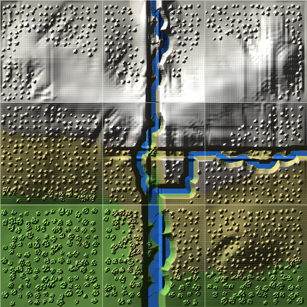

# Modular map builder

Procedurally generated, 3D-printable terrain **modules**, built one at a
time, that **mate with each other**: every side is a declared **class**, and
a side mates flush with any side of its class, whatever is on either module.
Channels are **drawn** across a module through the middle of any side, 10 mm
deep, with the cross-section of a parenthesis on its side, and cut as a
gorge where the line crosses high ground. Glaciers carve the ground and then
**melt out entirely**; a lake they dug can be clicked and made another size.
Modules **lock together** with a cam you turn with a coin, and stand on
hollow **spacer plates** so their channels line up.

No dependencies. Node 18 or newer and nothing else.

**[Build one in your browser](https://realpapanerf.github.io/Modular-map-builder/app/)** —
the same generator, nothing to install and nothing uploaded. Or on the
command line:

```bash
node bin/mmb.mjs example > module.json
node bin/mmb.mjs check module.json          # the contract and the channels, no ice
node bin/mmb.mjs build module.json --out out/
node bin/mmb.mjs plate --height 10,20       # spacer plates, if you want them
```



*The example: a 200 mm module with a range across the middle of it, the
glaciers' valleys down each flank, a cirque lake, and a channel from under
the crest out through the south port. Every side is class 20, its rim 22 mm high all the way
round; the only break in it is the port.*

---

## One module at a time

The first version of this built a 3 × 3 map and solved the whole thing at
once: every tile's rim followed the terrain, rivers crossed seams by
standing the downstream tile on a stack of plates, and nine pieces that fit
each other and nothing else. That is gone, on purpose. The builder now grows
**one module**, and the only promise a module makes is at its rim.

### The contract

Every side of a module is a **class**: the rim stands 2 mm (`baseMM`) more
than the class above the module's base, flat the whole way along. A side
mates flush with any side of its class; against a side of another class it
is a step, which is a cliff, and cliffs are terrain. The author picks each
side's class in the inspector (`contract.edges`, in rim millimetres).

| class | rim | a channel crosses at |
|---|---|---|
| 10 | 12 mm | 2 mm |
| 20 (default) | 22 mm | 12 mm |
| 30 | 32 mm | 22 mm |
| 40 | 42 mm | 32 mm |
| 50 | 52 mm | 42 mm |
| 60 | 62 mm | 52 mm |

The ladder carries on in tens to 190, so a side that is all mountain can
stand as high as the print. A channel crosses a side only at its **middle**,
`portWidthMM` (30) wide and `channelDepthMM` (10) deep, so water comes in at
12..52 mm and leaves at 2..42 mm, one class or more lower. A module that hands
its water to a lower one stands on spacer plates that make up the
difference, or the lower one's side is a lower class.

Across every port, in the last 3 mm before the seam, the bed has a **groove
for silicone** 1 mm deep (`grooveWidthMM`, `grooveDepthMM`). Lay a bead in it
on both modules; when they are locked the two beads press together and the
junction holds water.

Each side also says how the ground **meets** its rim (`contract.blends`): a
cliff, the ground standing right up to the edge and dropping to the rim in
the last few millimetres; or a slope, bent down over 60 mm or more.

The ground may go below the lowest rim a module has, for a lake or a low
floor, but it comes back up to every rim and never near the base.

The check that the whole repository exists to pass is still there: every
finished module honours every rim to **under a millionth of a millimetre**,
groove included, measured on the thing that will be printed.

```
Edges:
  N  land 22                err 0.0000 mm
  E  land 22                err 0.0000 mm
  S  channel 30@12 22       err 0.0000 mm
  W  land 22                err 0.0000 mm
  worst edge error 0.0000 mm — it mates
```

Where two sides of different classes meet at a corner, the step between them
is fanned in from the corner: each side's leftover is spread inward
weighted by the inverse square of the distance to it, so near the corner the
step turns through a narrow arc, and further in it widens and fades. The
corner vertex itself belongs to the north or south side.

### A level rim on sloping ground

A valley runs *down* through a module, and the rim is level, so the fall
across the module has to come out. The module is leaned onto its rim in two
parts (`conformToContract` in `lib/tile.js`):

- **The tilt.** The best-fit plane through the four rims' residuals is the
  module's overall fall, and it is subtracted everywhere. For a valley that
  falls steadily this leaves the valley's shape with its gradient gone.
- **The rest.** Whatever is left — a ridge running out through a side, a
  bump on the rim — is bent down to the rim over the last `rimBlendMM`
  (60 mm). Spread over the whole module instead, this would take a ridge
  that crosses both the east and the west sides out entirely, because the
  ruled surface between two equal residuals is a constant. Confined to a
  band, it does what a module's edge has to do anyway, and the mountain in
  the middle stands.

Ground that ends up below the rim — a trough the ice cut deeper than the
valley floor at the rim — is squeezed, smoothly, so that it never cuts
through the plate: nothing near the rim's height, saturating 6 mm above the
base. An overdeepening is still a basin, shallower than the metres say, and
the report says by how much.

### The margin

The ground is grown on a world that is the module plus a margin on every
side (`marginMM`, 60 mm by default, 30% of a module), and the module is cut from the
middle of it. A glacier pinned to zero thickness at the edge of its domain
cannot flow into a module from outside, and a mountain that stops dead at
the rim has no catchment. The margin is thrown away; it exists so the ice
has somewhere to come from. The ridge, a volcano and a flat can be drawn
out into it.

## Channels you draw

```json
"channels": [
  { "name": "main", "widthMM": 30, "depthMM": 10,
    "path": [[100, 200], [94, 160], [112, 118], [92, 72], [100, 0]] }
]
```

A channel is a line, a width and a depth, in module millimetres. It is cut
that deep below the ground along its line — **10 mm by default** — and
where either end comes within reach of a side it is **snapped to that
side's port**, so the module hands it over in the one shape every module
agrees on. An end inside the module shallows out to nothing rather than
stopping at a cliff.

**The cross-section is a parenthesis on its side.** One circular arc from
bank top, down through the thalweg, and up to the other bank top: no flat
floor and no break in slope where a bank starts. For a channel deeper than
half its width the arc is a semicircle under straight walls. `channelShape`
in `lib/contract.js` is that curve, and it is the one function both the rim
profile and the carve use, so the channel a module cuts inland is the same
curve it hands over at its edge.

**The floor follows the ground, and never rises.** A 10 mm channel is 10 mm
below the land along its line, with the ground smoothed along the line first
so the bed does not inherit every bump. But water does not run uphill, so
the floor is also held to the lowest it has been so far. A line drawn over
high ground cuts a **gorge** through it, as deep as the rise is high, and the
cross-section goes to walls. Where it meets a port it is eased onto that
port's floor over about a width. It only ever *cuts*: across a hillside the
uphill bank is the cut and the downhill bank is the hill. The report says
what happened:

```
note — main runs through high ground on its line, so it is cut as a gorge there,
up to 21.8 mm deeper than its 10 mm: water does not run uphill.
note — main's line goes 2.1 mm below the floor of the S port before it gets there,
so the water stands that deep behind the port before it spills out.
```

A channel that comes in by a side of the same class or lower than the side it
leaves by is warned about before anything grows: there is no fall.

**Or let the generator route it.** A channel given as two ends and no line
is routed down the valley when the module grows: least cost over the
ground, paying for distance, for height and for climbing, with a little
wander on the flat and meanders where the valley has room. An end is a side
(`"S"`) or a point on the module (`[100, 62]`). The example's channel is one
of these, so it follows the valley whatever the seed; the inspector's
*Take the line it found* turns it into a drawn one you can drag.

Widths are free — the editor offers 20, 30, 40 and 60 mm bank to bank — and
at the rim a channel is the port's width whatever it is inland. A channel may
come in and go out by any two sides, and take any line between. Two channels
cannot leave by one side; there is one port a side.

## How the ground is grown

The shapes that make mountain country recognisable — the U trough, the
cirque biting into the divide, the arête, the horn, the tower — are the
signature of processes, and no noise function fakes them. So the ground is
grown, in this order:

1. **Uplift.** The ridge you draw, volcanoes, flats, and a hollow wherever
   you put a **cirque** (`lib/terrain.js`).
2. **Rivers.** Running water cuts branching valleys into the range before
   any ice arrives (`lib/fluvial.js`, the stream-power law). A glacier does
   not invent its valleys; it takes over the ones rivers cut. Started on a
   smooth bump instead, the ice only combed parallel grooves down the flanks,
   which is why the first version's mountains came out as rounded loaves.
3. **Ice.** Shallow-ice flow with sliding, abrasion, quarrying, moraines and
   a snowline that swings so the ice advances and retreats
   (`lib/glacier.js`). It widens the river valleys into U troughs and
   gathers first in the cirques, which bite back into the ridge. The
   snowline sits lower on slopes facing the shade (north by default) and
   lower again in a cirque, so cirques crowd onto the shaded side as they
   do in real ranges. By default the coldest snowline stands 45% of the way
   from the plain up to the peaks, which gives valley glaciers rather than
   an ice cap whatever the ground looks like.
4. **Frost and towers.** A fine pass at 1 mm of print a cell, over the module
   only (`lib/detail.js`). The rock is **jointed** (`lib/rock.js`): two sets
   of near-vertical cracks a few hundred metres apart, the way Fitz Roy's
   or the Tetons' granite is. Frost attacks exposed tops and steep faces,
   fastest along the joints; sound rock stands at up to 82 degrees and a
   joint at 40; low ground is under soil at 34. What is left between the
   joints stands as towers, and the gullies run down the weak lines.

Two things the old version got wrong, fixed:

- The step that slumps loose moraine to 33 degrees ran over the whole bed,
  rock included, so no glaciated module ever had a slope steeper than that.
  It now moves only ground the ice built up.
- Soil creep ran everywhere at a rate that spread the ground over about
  200 m, eight millimetres of print. It is now fast on gentle ground, where
  it fills quarrying pits and rounds moraines, and slow on steep rock.

**Vertical exaggeration** (`verticalExaggeration`, 2 in the example). A real
range seen from above is flat: the Grand Teton stands 2100 m over Jackson
Hole, 42 mm on a 10 km module. Real mountains look sheer because they are
seen from below, and a model on a table is seen from above. So the print can
stand taller than the ground it is grown from. Heights you type stay the
heights printed; the rivers and the ice see ground that much lower in real
metres, and cut proportionally deeper.

| Peak | Fits in | Scale | Printed at 1× | At 2.5× |
|---|---|---|---|---|
| Matterhorn | 6 km | 30 m/mm | ~45 mm | ~110 mm |
| Fitz Roy group | 10 km | 50 m/mm | ~44 mm | ~110 mm |
| Grand Teton | 10 km | 50 m/mm | ~42 mm | ~105 mm |
| Timpanogos | 12 km | 60 m/mm | ~37 mm | ~92 mm |

**Cirques where you want them.** The Cirque tool in Draw: press where a
glacier bowl should be and drag the way it opens, downhill. A hollow is cut
there before the rivers, and the snowline is lowered there, so the ice
gathers in it first and bites its headwall back into the ridge. Three or
four round one summit carve a horn, the way the Matterhorn was.

A full grow of the example takes about 75 s: the ice is most of it, on a
112-cell grid over the module and a 60 mm margin; the fine pass about 11 s.

### The ice melts out at the end

The end of the run. The cosine schedule ends warm, but warm
is not gone: the last advance's remnants were still sitting in the cirques
when the run stopped, and on the finished map the summits were painted white
over ground the ice had smoothed, which read as the ice still being there.
So:

- **The ice melts out.** After the last cycle the snowline is lifted clear
  of the summits and the ice is relaxed until there is none. Whatever till
  it was still carrying grounds where it is, as ablation till; what the
  moraine rail will not let stand leaves as outwash, counted. The report
  says how much ice the climate left behind and that **0.0 m remains**, and
  a test asserts the final ice is zero everywhere.
- **The tops are rock.** The hillshade and the 3D view colour the highest
  ground grey-brown, not white.
- **A tarn has to be a tarn.** The hollows the ice leaves are filled with
  water, as before, but a hollow has to be 150 mm² and 1.5 mm deep to count:
  ground pocked with twenty puddles read as a crevassed ice field, not as a
  valley with a lake in it.

What you see is the bed: cirques, troughs, moraines, the lakes behind them.
`glacier.meltOut: false` keeps the old ending, for comparison.

## Lakes you can resize

The ice may dig large lakes, and they are kept. Every body of water the
build makes is measured along its long axis. Click one in the 3D view or on
the flat view and the inspector shows how long and wide it is, its bearing,
area, depth and the epoxy it takes. A tarn the ice dug can be made another
size there:

```json
"lakes": { "resize": [ { "atMM": [96, 118], "lengthMM": 30, "widthMM": 40 },
                       { "atMM": [40, 160], "fill": true } ] }
```

A resize is found again by where it is, so it survives a regrow that leaves
the hollow roughly in place, and the report says when one finds nothing.
The tarn keeps its own outline, scaled about its middle. Where it gets
smaller the hollow is filled to a flat just above the water, a lake that
silted up. Where it gets bigger the bank is dug out, and any low ground at
its new edge is raised to hold the water in. `mmb check` lists every lake's
middle and size, to write a resize against.

## Locking modules together

A **cam lock** on every side (`lib/joint.js`, `lib/cam.js`). Either side of
the port, 50 mm out, every side has a cam housing and a key pocket. Walking
round a shared seam the two modules run opposite ways, so one module's cam
always meets the other's key, whichever two modules they are.

Everything is in the **underside**. Nothing shows on the top: no bore, no
coin slot, and no flattened ground round a cam.

- **The key** is flat and 4 mm thick. A pad sits in a pocket in one
  module's underside, a neck runs out through its face, and a round head
  sticks out into the other module.
- **The cam** is an 18 mm cylinder, 8.4 mm tall, in a blind bore 8.4 mm up
  into the other module's underside. One end is hollowed into a spiral. A
  quarter turn with a coin draws the key's head 1.5 mm toward its axis,
  with a 10° dwell at the end so it holds. That pulls the pad onto the
  shoulder of its pocket and the faces together, with 0.2 mm of preload.
  Every cam is the same height, whatever the ground over it.
- **Assembly.** Lay the modules face down on the table, butted together.
  Drop a key into each seam: the pad falls into one module's pocket, the
  neck and head into the next module's entry channel and bore. Drop a cam
  into each bore over the head, hook end first, coin slot up. Turn each a
  quarter turn with a coin. Then turn the map over and play on it. To take
  one module out, turn the map over, turn back its cams and the
  neighbours' cams on its sides, and lift the keys out.

Print one key per pocket and one cam per housing; the editor and `mmb build`
write `keys.stl`, `key-one.stl`, `cams.stl` and `cam-one.stl`. The pockets,
the entry channels and the bores are all 8.4 mm deep and keep 1.6 mm of
plastic over them, so the ground over a lock has to stand at least 10 mm.
A feature where it does not, or that would run into a tube bore, is left
out whole and reported.

## Spacer plates

Not part of a module: plates are there to print when you want them, in 10,
20, 30, 40 or 50 mm (`lib/plate.js`).

```bash
node bin/mmb.mjs plate --height 10,20,30,40   # plate-10.stl ... and pins.stl
node bin/mmb.mjs build module.json --out out/ --plates 10,20
```

- **A milk carton, not a brick.** An open-bottom shell with a 2 mm top
  skin, 2.4 mm walls and ribs on a 40 mm grid, solid only in the corners and
  under the locks: 61% hollow. Printed upside down, skin on the bed, it needs
  no support.
- **Holes for fountain tubing** through the skin, 16 mm on a 20 mm grid, so a
  12.7 mm tube anywhere on that grid goes straight down the stack. 72 of the
  100 grid positions have one; the rest are too near a lock or a socket.
- **The same cam lock** on its sides as a module, cut up into its solid
  blocks from below, so a plate locks to whatever stands beside it at its
  level, assembled face down with the modules. In the 10 mm plate the bores
  leave exactly the 1.6 mm a module keeps over them.
- **Stacking.** A socket in each corner of both faces, in the same four
  places a module's underside has them, and a loose pin (`pins.stl`) for
  each. Nothing stands proud of either face.

## The rest of the module

Everything that was already here still is, per module rather than per map.

- **Standing water** (`lib/lake.js`): tarns in the hollows the ice left,
  lakes placed at a point or painted along a stroke, each a hole you can
  pour clear epoxy into, with the millilitres reported.
- **Springs** (`lib/fountain.js`): a pool with a lip and one notch, and a
  tube bore straight down through the module. `fountains.auto` puts one at
  the start of every channel, which is where a pump has to put the water.
  `build` writes a tray for the module to stand in.
- **Woods** (`lib/canopy.js`): conifer spires and broadleaf cauliflower,
  placed and stamped, with a treeline in module millimetres. No tree ever
  crosses the rim.
- **Edits by hand** (`lib/edits.js`): raise, lower, smooth, flatten, plant
  and clear, kept as strokes and replayed every time the module grows, so a
  new seed keeps them. The last 12 mm of the rim is locked.

## In the browser

[**realpapanerf.github.io/Modular-map-builder/app/**](https://realpapanerf.github.io/Modular-map-builder/app/)

Four stages over one spec, the spec being the document:

| stage | what it does |
|---|---|
| **Draw** | the module flat, with its margin round it. Channel, Water, Spring, Ridge, Volcano, Flat, Wood. Every tool writes the spec; a hillshade of the ground without its ice lies under the grid while you draw |
| **Grow** | runs the generator in a worker, then stands the module up in 3D as it will print, water in its channels and lakes |
| **Refine** | brushes on the grown ground in 3D: raise, lower, smooth, flatten, paint water, plant, clear, a spring. Every stroke is kept as an edit and the module grows again with it, keeping the ice from last time |
| **Print** | the report and the files: the module's STL, its keys and cams, the tray, and spacer plates if wanted |

The **Channel** tool is a drag: start or finish on a port mark — the middle
of a side — to cross the rim there, or anywhere within 30 mm of a side, and
the end snaps to its port. The line is shown snapped, with its width, while
you draw. Width and depth are in the palette. Nothing leaves the machine,
and the JSON is in a drawer if you want it.

A spec written for the old board — several tiles, rivers between them — is
refused with a sentence rather than guessed at: which of its nine tiles
would it be?

## The spec

Everything is millimetres on the module, x east, y north, from its
south-west corner. A point may be outside 0..200: that is the margin.

```json
{
  "name": "hanging-valley", "seed": 7, "meshMM": 0.9, "metresPerMM": 25, "marginMM": 60, "verticalExaggeration": 2,
  "spineHeightMM": 60, "spineWidthMM": 95,
  "spine": [[-100, 112], [30, 98], [105, 104], [190, 94], [300, 86]],
  "glacier": { "cycles": 24, "elaSwingMM": 18 },
  "cirques": [{ "at": [78, 122], "facingDeg": 100 }],
  "channels": [{ "name": "main", "widthMM": 30, "depthMM": 10, "from": [100, 62], "to": "S" }],
  "canopy": [{ "kind": "conifer", "crownMM": 7, "heightMM": 9, "density": 0.4, "minZMM": 28, "maxZMM": 54 }],
  "lakes": { "fillHollows": true, "depthMM": 5, "shoreMM": 10, "profile": "dish",
             "place": [{ "atMM": [60, 140] }, { "pathMM": [[30, 40], [70, 60]], "radiusMM": 12 }] },
  "fountains": { "auto": true, "tubeOdMM": 12.7, "poolRadiusMM": 16, "place": [{ "atMM": [150, 150] }] },
  "edits": [{ "op": "raise", "path": [[30, 45], [90, 45]], "radiusMM": 12, "mm": 8 }],
  "contract": { "tileMM": 200, "edgeLandMM": 22, "edges": { "N": 42 }, "blends": { "N": 6 },
                "portWidthMM": 30, "channelDepthMM": 10 }
}
```

`metresPerMM` is the one place metres appear: the generator works in real
metres, because that is the only scale on which ice behaves like ice, and
25 m per millimetre makes a 200 mm module 5 km of country. The commented
version of this is `lib/example.js`.

## Layout

```
lib/contract.js    the edge contract: the classes, the port, the ) cross-section, the groove
lib/channel.js     channels: snapping to ports, routing down the valley, the floor, the carve
lib/tile.js        metres to millimetres: cut from the world, leaned onto the rim, squeezed
lib/build.js       buildWorld (uplift, ice, gravity) and buildTile (the module)
lib/terrain.js     uplift: spine, roughness, flats, volcanoes, cirque hollows
lib/fluvial.js     rivers: stream-power incision, before the ice
lib/glacier.js     shallow-ice flow with sliding, till, the shaded side, and the melt-out
lib/rock.js        jointed rock: how weak it is, and how steep it may stand
lib/detail.js      the fine pass after the ice: frost, towers, gullies
lib/hillslope.js   critical-angle failure, and creep
lib/basins.js      closed hollows, by priority-flood
lib/lake.js        tarns, lakes placed and painted
lib/fountain.js    spring pools, tube bores, and the tray
lib/joint.js       the cam lock: where it goes, cutting it into a module, the key
lib/cam.js         the cam: its spiral hollow, its coin slot, as a closed solid
lib/plate.js       the spacer plates and their pins
lib/canopy.js      woods
lib/edits.js       edits by hand, kept as operations and replayed
lib/mesh.js        height field -> closed solid, with bores and a watertightness check
lib/stl.js         binary STL
lib/shade.js       the hillshade, as RGB; preview.js wraps it as a PNG
lib/scale.js       metres per millimetre, the margin, and the old-board refusal
lib/example.js     the worked example
bin/mmb.mjs        command line
app/               the editor: main.js holds the state, tilecanvas.js and features.js
                   draw, tools.js and inspector.js edit, specops.js is every edit as a
                   function of the spec, worker.js grows, viewer.js stands the module up
                   in 3D from heights.js's arrays
lib/vendor/        three.js r169 and OrbitControls, MIT
test/              node --test, plus browser.mjs for the editor in Chromium
```

## Tests

```bash
npm test
npm run test:browser      # the editor in Chromium; needs Playwright, skips without it
```

The ones that earn their keep:

- the finished module honours its edge contract **exactly** (< 1e-6 mm),
  and is a **closed solid**
- **two modules built to one contract mate**: different seeds, different
  channels, and the east edge of one is the west edge of the other to the
  last sample, port and all
- the cross-section is a circular arc through the bank tops and the
  thalweg, monotone from the centre out, a semicircle under walls when it is
  deeper than it is wide
- a channel is cut the contract's depth below the ground along its line,
  only ever cuts, snaps an end near a side to its port, and leaves the port
  exactly on the contract whatever its own width and depth
- a routed channel follows the valley the glacier left, will not climb a
  ridge to save distance, meanders on a floodplain and stays put in a gorge
- the module is cut from the middle of its world; a plane tilt leaves the
  middle at the datum; a hole deeper than the plate is squeezed, never cut
  through
- **the ice melts out entirely before the bed is handed on**, on a cold
  climate that would otherwise have left ice in the valley; with the melt
  off, it does
- till conserves mass, with the melt's outwash counted
- every side has its own class; a side of a class mates with any side of
  that class, and a corner between two classes steps
- every port is rebated for silicone at the seam
- a channel's floor never rises: over a rise it cuts a gorge, and a line
  that goes below its exit port's floor ponds behind it, and says so
- a lake resized by hand comes out the size asked for; one filled in is dry
- every side gets a cam and a key, mirrored about its middle, so any two
  modules' halves meet; the turn ends tight, with preload; the cam and the
  key agree on where the head is
- the cam, the key, the plates and the pins are closed solids; a plate is
  mostly hollow, flat on both faces, and has its holes where every other
  plate has them
- the example can be drawn from a blank module with the tools alone, in node
  and in Chromium with the mouse, the JSON never opened
- a channel drawn with the mouse snaps its ends to the ports and takes the
  palette's width and depth; a routed one can take the line it was grown with
- a draft build is on screen in 3D within a few seconds of the heights
  landing, with water in the channel and **no ice**; orbiting is smooth and
  draws nothing once it has stopped
- a brushstroke in Refine is written as an edit, previewed at once, grown
  again, and undone
- a raised ridge survives a change of seed with the edge check still at zero
- an old board spec is refused, in the CLI and in the editor

## Status

Working and tested end to end: the edge classes, the channels drawn and
routed with the gorge rule, the silicone groove, the module cut and leaned
onto its rims, the ice carving and melting out, lakes and their resizing,
springs, woods, the cam lock, the spacer plates, hand edits, the editor's
four stages, the CLI.

Not yet printed: the cam lock's clearances are a first guess and want a test
print of `key-one.stl` and `cam-one.stl`.

Under-tuned, as before: glacial U-widening (`valleyForm` is the metric,
`elaM` and `erosionK` the levers), and now also how hard the ice may dig
relative to a 22 mm rim — a trough deeper than the rim has room for comes
out as a lake behind the port. The lakes are kept on purpose; resize the
ones you do not want that big.

Two design documents in `docs/` pre-date the one-module model and say so at
the top: a staged pipeline, and telling the ice where to go. The questions
from the one-module refactor, their answers and what was built for them are
in [`docs/open-questions.md`](docs/open-questions.md).

## Licence

MIT. See [LICENSE](LICENSE).
